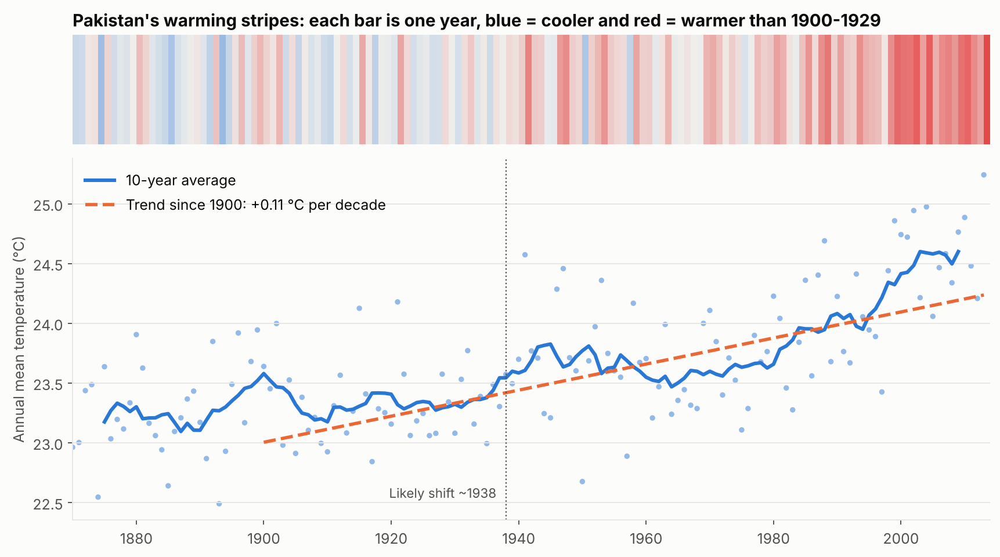

# Climate and Agriculture in Pakistan: Exploratory Data Analysis



An exploratory data analysis (EDA) of public climate and crop data, with a focus on Pakistan. It is a learning and portfolio project, built to practise a reproducible data-analysis workflow and trend testing used in hydrology and climate studies.

**Author:** Sumbal Fatima, BSc Agricultural Engineering, University of Agriculture, Faisalabad

**[Interactive dashboard](https://sumbal-fatima.github.io/Pakistan-Climate-Agriculture-EDA/)** · **[Full notebook page](https://sumbal-fatima.github.io/Pakistan-Climate-Agriculture-EDA/notebook.html)** · [Notebook source](notebooks/01_eda_climate_agriculture_pakistan.ipynb)

## Questions
1. How do record climate extremes differ between Peshawar and Gilgit?
2. Has Pakistan's temperature changed over the long record?
3. How have Pakistan's crop yields changed since 1990, and how do they compare with other countries?

## Data (Kaggle, not redistributed here)
Download these and place the CSVs in `data/` as named below.

| File in `data/` | Source |
|---|---|
| `peshawar.csv` | [Peshawar climate: temperature and rain trends](https://www.kaggle.com/datasets/tayyarhussain/peshawar-climate-temperature-and-rain-trends) |
| `gilgit.csv` | Gilgit climate record (same author, Tayyar Hussain) |
| `yield_df.csv`, `temp.csv` | [Crop Yield Prediction Dataset](https://www.kaggle.com/datasets/patelris/crop-yield-prediction-dataset) (FAO and World Bank data) |

## Methods
- A dedicated data-cleaning section: first look at each raw file, a cleaning log with row counts before and after every step, and outlier and missing-value checks
- Descriptive statistics and distributions, log transform for skewed yields
- Pettitt change-point test, warming-stripes visualisation, and wheat comparison with India and Egypt
- Hamed-Rao autocorrelation-corrected trend test and 95% confidence intervals (Theil-Sen), because yearly temperatures are autocorrelated (lag-1 = 0.57)
- Mann-Kendall trend test and Sen's slope (`pymannkendall`), chosen because they do not assume normally distributed data and are robust to outliers
- Spearman correlation, including year-to-year changes to avoid misleading shared trends

## Key findings
- **Pakistan's temperature rose significantly since 1870**, by about 0.09 °C per decade over 1870-2013, 0.20 over 1950-2013 and 0.30 over 1980-2013 (Mann-Kendall, p < 0.001 in every period). Decade means rose from 23.6 °C in the 1900s to 25.0 °C in the 2010s.
- **The warming result is robust.** Every period stays significant after correcting for autocorrelation, and all 95% confidence intervals exclude zero (for example +0.11 °C per decade since 1900, interval 0.08 to 0.13).
- **A change-point test puts the largest single step at about 1940** (mean 23.6 to 24.2 °C), but the series keeps warming afterwards, faster after 1980, so one step is not the full story.
- **Record highs are more recent in Gilgit:** 6 of its 12 monthly record highs were set in 2000 or later, against 3 of 12 for Peshawar. This is suggestive only, with 12 values per city and different record start years.
- **Peshawar is hotter and wetter at the extremes:** record high 50.0 °C and heaviest monthly rainfall 904.5 mm, against 46.3 °C and 267.5 mm for Gilgit, whose record low is -11.1 °C.
- **Most Pakistani crop yields rose, 1990-2013:** significant increases for maize, potatoes, rice, wheat and sorghum, none for soybeans or sweet potatoes. Maize jumped abruptly after about 2002 rather than rising steadily.
- **Wheat grew as fast as India's but from a low base:** both up about 50% since 1990. Pakistan ranks 47th of 82 countries, and the top-10 average yield is 3.1 times Pakistan's.
- **No clear evidence here that temperature drives yield changes.** Raw yield-temperature correlations look high only because both rise over time. Correlating year-to-year changes gives weak or mixed values (-0.28 to 0.53), and with 23 years this says nothing about cause.

## Data quality issues found
- `yield_df.csv` has 2,310 exact duplicate rows and 15,112 rows repeated on country, crop and year, because station temperatures were joined and repeated. These were consolidated, leaving 13,130 rows.
- **Rainfall in `yield_df.csv` is a single fixed value per country** for all years (true for all 101 countries). It cannot show year-to-year variation, so it was not used to explain yields.
- The Peshawar and Gilgit files are 12-row monthly record tables, not yearly series, so they were analysed descriptively and not with trend tests.
- `temp.csv` has many exact repeated rows (a typical Pakistan year has 9 rows but only 6 distinct values). They were removed before averaging. The warming trend since 1900 is almost the same either way (0.109 vs 0.108 °C per decade).
- The Pakistan series in `temp.csv` swings between about 17.5 °C and 27.5 °C before 1870, which is implausible for a national mean. It was excluded from trend tests.

## Limitations
This is exploratory work. Trend tests show that something changed, not why. Station-averaged temperature is not homogenized, record tables are small, and crop data covers only 24 years.

## Interactive dashboard and notebook page
- Dashboard: https://sumbal-fatima.github.io/Pakistan-Climate-Agriculture-EDA/ (hover, switch start year, choose a crop)
- Full notebook with all charts: https://sumbal-fatima.github.io/Pakistan-Climate-Agriculture-EDA/notebook.html
- Rebuild the dashboard with `python scripts/make_dashboard.py`. It is hosted free with GitHub Pages (Settings > Pages > `main` / `/docs`).

## Reproduce
```bash
pip install -r requirements.txt
jupyter notebook notebooks/01_eda_climate_agriculture_pakistan.ipynb
python scripts/make_dashboard.py   # optional: rebuild the interactive page
```
Figures are saved to `figures/`.

## Possible next steps
Use real yearly rainfall for Pakistan, analyse basin-level hydrology data, and add detrended or lagged yield-climate models.
